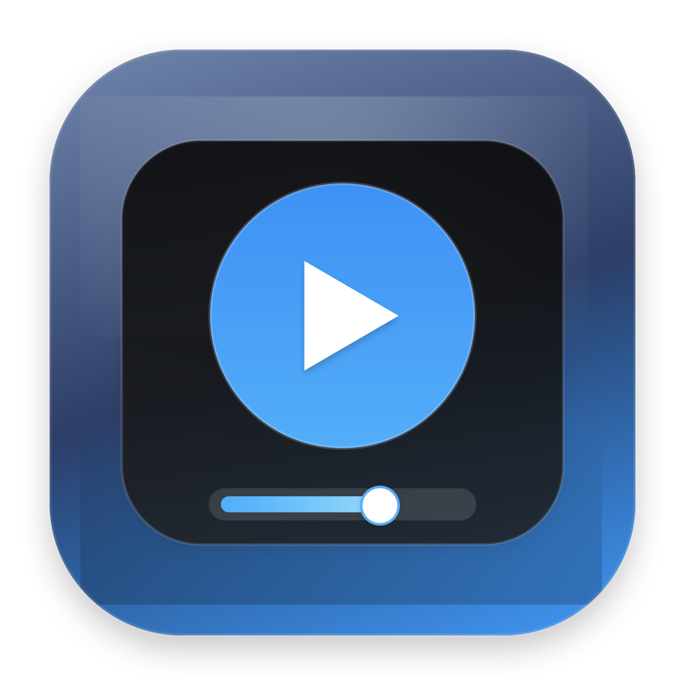
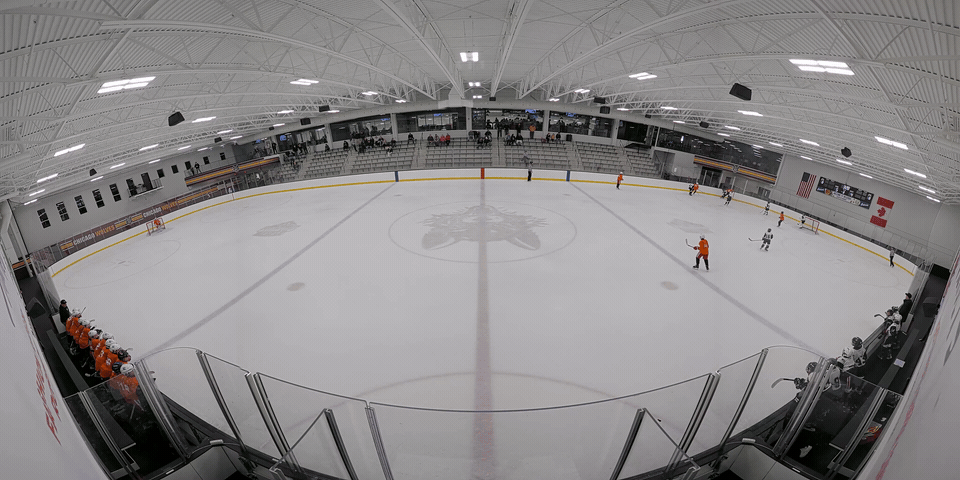
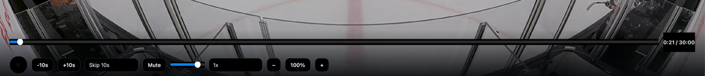

# Video Player

[](https://github.com/wfrancis/VideoPlayer/actions/workflows/ci.yml)
[](https://github.com/wfrancis/VideoPlayer/releases)
[](LICENSE)

QuickTime is too limited. VLC is too bloated. Most free `.mp4` players still miss the basic features people actually want.

Video Player is an open source macOS player built around the stuff that actually matters in daily use: smooth scrubbing, real skip controls, zoom and crop modes, subtitle timing, playback memory, fullscreen, mini-player mode, and a scriptable local control API.



## Demo





## Features

- Smooth timeline scrubbing with `5s`, `10s`, and `30s` skip intervals
- Optional Remote Mode for one-handed replay with Xencelabs Quick Keys, even while another app has focus
- Zoom, fit, fill, and stretch crop modes
- Playback speed control from `0.25x` to `3x`
- Keyboard shortcuts for play/pause, seek, fullscreen, mute, zoom, and crop modes
- External `.srt` subtitle loading with enable/disable, delay, size, and color controls
- Resume playback memory for longer videos
- Fullscreen mode and always-on-top mini-player mode
- Drag-and-drop open
- Local HTTP control API for automation
- MCP bridge for tool-driven control

## Project Layout

- `video_player.py`: main desktop app
- `video_player_metadata.py`: version, bundle, and settings metadata
- `video_player_mcp/server.py`: MCP bridge to the local HTTP API
- `video-player-build/`: icon generation, packaging, smoke tests, and release scripts

## Requirements

- macOS 11+
- Python 3.14 recommended
- Homebrew or another Python install with Qt multimedia support

Install runtime dependencies:

```bash
python3 -m pip install -r requirements.txt
```

## Run Locally

Launch the player:

```bash
python3 video_player.py
```

Open a file directly:

```bash
python3 video_player.py /absolute/path/to/video.mp4
```

Disable the local control server:

```bash
python3 video_player.py --no-control-server
```

Change the control port:

```bash
python3 video_player.py --control-port 9988
```

## HTTP Control API

By default the app starts a local HTTP server on `127.0.0.1:9876`.

Useful endpoints:

- `GET /health`
- `GET /state`
- `POST /play`
- `POST /pause`
- `POST /toggle`
- `POST /skip`
- `POST /seek`
- `POST /speed`
- `POST /volume`
- `POST /mute`
- `POST /zoom`
- `POST /reset_zoom`
- `POST /pip`
- `POST /view_mode`
- `POST /fullscreen`
- `POST /subtitles/open`
- `POST /subtitles/enabled`
- `POST /subtitles/delay`
- `POST /subtitles/size`
- `POST /subtitles/color`

Example:

```bash
curl -s http://127.0.0.1:9876/state
curl -s -X POST http://127.0.0.1:9876/skip \
  -H 'Content-Type: application/json' \
  -d '{"seconds": 10}'
```

## MCP Bridge

The MCP bridge lets external agent tooling control a running player instance:

```bash
python3 video_player_mcp/server.py
```

If the player is listening on a different base URL:

```bash
VIDEO_PLAYER_BASE_URL=http://127.0.0.1:9988 python3 video_player_mcp/server.py
```

## Build A Standalone App

Install build dependencies:

```bash
python3 -m pip install -r requirements-build.txt
```

Package the macOS app:

```bash
./video-player-build/package_app.sh
```

That script will:

- regenerate the icon
- build a standalone `.app` with PyInstaller
- ad-hoc sign the app for local use
- produce a `.zip` and `.dmg`
- optionally replace the installed copy in `/Applications`

Run the smoke test after packaging:

```bash
./video-player-build/smoke_test.sh "/Applications/Video Player.app" /tmp/video_player_resume_test.mp4
```

More release details live in [video-player-build/README.md](video-player-build/README.md).

## Keyboard Shortcuts

- `Space` or `K`: play/pause
- `Left` / `Right` or `J` / `L`: seek by the selected skip interval
- `Shift+Left` / `Shift+Right`: seek `10s`
- `Option+Left` / `Option+Right`: seek `30s`
- `F`: fullscreen
- `M`: mute
- `Z` / `Shift+Z`: zoom in or out
- `0`: reset zoom
- `C`: cycle crop mode
- `P`: mini-player
- `,` / `.`: subtitle delay

## Xencelabs Quick Keys Remote Mode

Click **Remote Mode** next to the playback controls to use Quick Keys while entering stats in another app. Click it again to release the shortcuts. The timeline, playback buttons, and regular keyboard shortcuts are available in either mode.

1. Connect Quick Keys with its USB receiver or cable and install the macOS driver. [Xencelabs drivers](https://www.xencelabs.com/us/support/download-drivers)
2. In Xencelabs Settings, choose **My Quick Keys → All Other**. Under **Dial Mode 1**, choose **Keystroke**. Use **Add Special** to select the function keys in the table. Assign play/pause to one of the side buttons. The dial's center button switches dial modes. [Xencelabs dial setup](https://solutions.xencelabs.com/en/support/solutions/articles/67000704399-setting-up-your-quick-keys-for-adobe-premiere-pro)

   | Control | Key | Video Player action |
   | --- | --- | --- |
   | Dial counterclockwise (top field) | `F16` | Jog backward ¼ second |
   | Dial clockwise (bottom field) | `F18` | Jog forward ¼ second |
   | A programmable side button | `F17` | Play or pause |

3. Switch Quick Keys to that dial mode and click **Remote Mode** in Video Player. If your stats app or Video Player already has a custom Quick Keys profile, copy the same mappings into that profile. [Xencelabs app profiles](https://solutions.xencelabs.com/en/support/solutions/articles/67000685362-how-many-applications-can-i-customize-within-the-xencelabs-driver-)

## Open Source

This project is released under the [MIT License](LICENSE).
